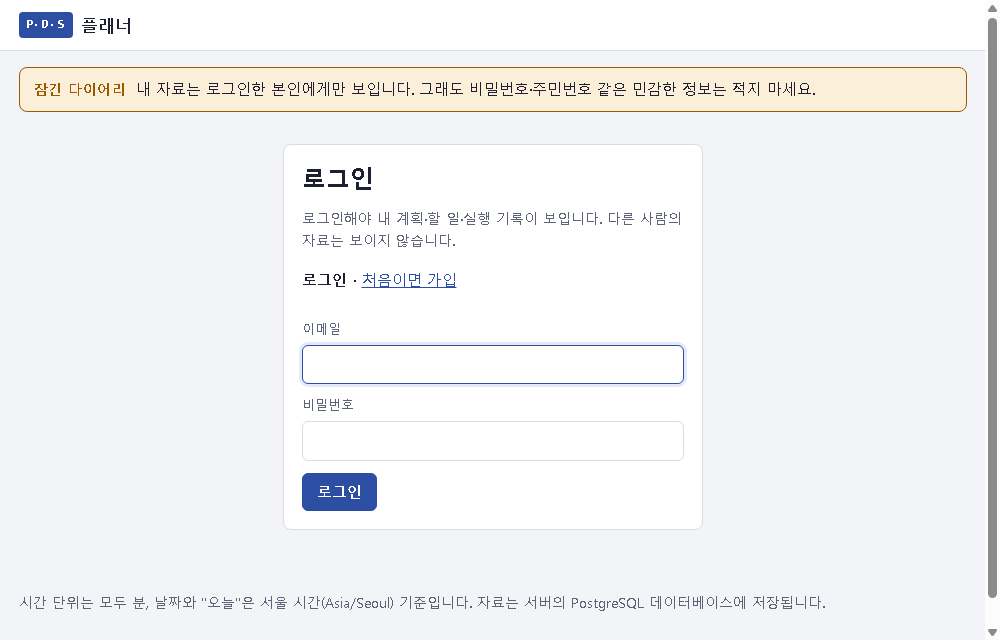
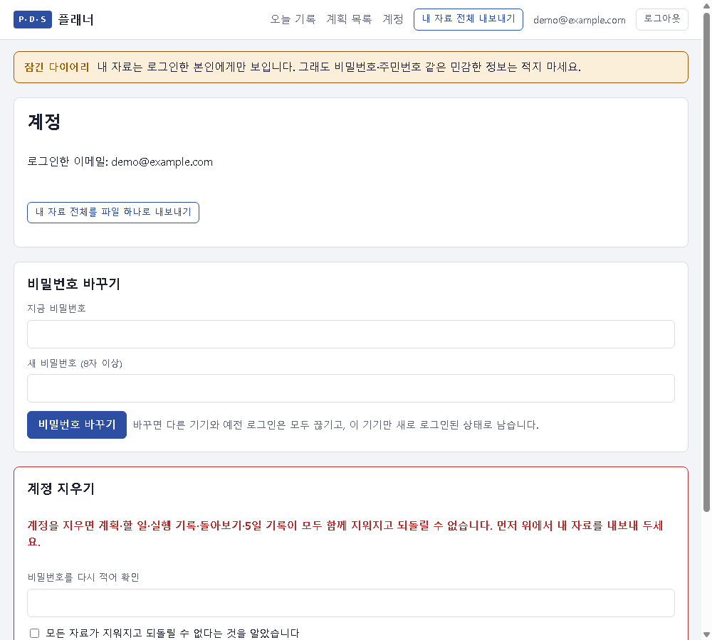

# 인증 구현 설명서 (7번 과제)

6번에서 만든 PDS 플래너(다이어리)에 가입·로그인을 붙여 **내 자료는 나만** 보이게 했습니다.
흐름은 **로그인 → 오늘 기록(할 일·실행 기록·5일 기록) → 로그아웃**입니다.

- 결과물: `https://aleph-t06-zeta.vercel.app` — 첫 화면은 로그인 화면입니다
- 소스: `https://github.com/null210/ALEPH-T06`
- 이어 붙인 6번 결과: 같은 저장소의 6번 최종 커밋 `1e7650f`. 7번 커밋은 그 위에 쌓여 있어서 6번 커밋이 조상으로 들어 있습니다
- 전체 확인 기록(요청·응답 63개): 로컬 [evidence-local.md](evidence-local.md) · **배포 사이트 [evidence-production.md](evidence-production.md)**

> 이 문서와 확인 기록에서 **비밀번호와 세션 쿠키는 모두 앞 5글자만 남기고 `…생략`으로 가렸습니다.**
> 확인에 쓴 계정은 확인 스크립트가 그때그때 만든 시험 계정이고, 확인이 끝나면 지웠습니다. 진짜 계정의 비밀번호는 어디에도 적지 않았습니다.

---

## ① 무엇으로 붙였나

**직접 구현했습니다.** 인증 라이브러리나 인증 서비스는 쓰지 않았습니다.

| 부분 | 쓴 것 (이름·버전) |
|---|---|
| 비밀번호를 되돌릴 수 없게 바꾸기 | **scrypt**. Node.js **v24.22.1**에 들어 있는 `node:crypto`의 `scrypt`(OpenSSL 구현)를 씁니다. 설정은 N=32768, r=8, p=1, 결과 32바이트이고, 계정마다 무작위 소금 16바이트를 씁니다 |
| 사람 알아보기 | **세션**(서버가 기억하는 방식)입니다. 토큰을 서명하는 JWT는 쓰지 않았습니다. 로그인하면 `node:crypto`의 `randomBytes(32)`로 무작위 값을 만들어 쿠키 `pds_sid`로 줍니다. DB(`sessions` 표)에는 그 값의 **SHA-256 결과만** 둡니다 |
| 서버·DB | Express **5.3.0**, pg **8.23.1**(배포: Supabase PostgreSQL, Vercel 연동), @electric-sql/pglite **0.5.10**(로컬·테스트). 6번과 같습니다 |
| Supabase REST 막기 | 6번처럼 7번에서 새로 만든 표(`users`·`sessions`·`login_failures`·`experiments`·`daily_entries`·`rule_changes`)에도 RLS(행 수준 보안)를 정책 없이 켰습니다. Supabase가 자동으로 열어 두는 REST API로는 비밀번호 저장값이나 세션 표를 읽을 수 없습니다 |
| GitHub·Google 로그인 | **OAuth 2.0 인가 코드 방식**을 직접 구현했습니다(라이브러리 없음). 요청 위조를 막는 `state`(무작위 32바이트, 10분짜리 HttpOnly 쿠키)를 쓰고, Google에는 **PKCE(S256)**를 더 씁니다. 제공자에게서 받은 것은 "인증된 이메일"과 제공자 쪽 사용자 번호뿐이고, 로그인이 끝나면 **위와 같은 서버 세션**을 줍니다. client secret은 Vercel 환경 변수에만 두고 서버끼리 주고받는 요청에만 씁니다. 환경 변수가 없는 제공자는 버튼이 안 보입니다 |
| 쿠키 속성 | `HttpOnly; SameSite=Lax; Path=/; Max-Age=604800`, 배포(https)에서는 `Secure`도 붙습니다 |

**직접 만든 부분과 맡긴 부분.** 비밀번호를 바꾸는 계산(scrypt)은 Node에 들어 있는 OpenSSL 구현에 맡겼습니다. 제가 직접 짠 것은 그 둘레입니다: 소금 만들기, 저장 형식(`scrypt$N$r$p$소금$결과`), 비교(`timingSafeEqual`), 세션 만들기·확인·지우기, 실패 횟수 제한, 그리고 GitHub·Google 로그인 흐름 전체(`state`·PKCE 만들기와 확인, 코드 → 토큰 교환, 계정 연결). 이 부분은 널리 쓰이는 라이브러리가 아니라 **직접 만든 코드**입니다.

## ② 왜 그걸 골랐나

**직접 구현(서버 세션)을 고른 이유**

1. **로그아웃과 비밀번호 변경이 진짜로 끊겨야 했습니다.** 서명한 토큰(JWT)은 서버가 기억하지 않아서, 로그아웃해도 만료 전까지는 그대로 통합니다. 서버 세션은 DB 행을 지우면 그 순간부터 거절됩니다.
2. **이미 PostgreSQL이 있었습니다.** 표 세 개(`users`, `sessions`, `login_failures`)만 더하면 됐습니다.
3. **주인 검사는 어차피 내 API의 SQL에서 해야 합니다.** 어떤 로그인 방식을 쓰든 남의 자료를 막는 일은 내 코드 몫입니다. 로그인까지 같은 코드 안에 두면 "누가 요청했나 → 그 사람 것만 찾는다"를 한 흐름으로 읽을 수 있습니다.
4. **비밀키가 필요 없습니다.** 세션 값은 무작위로 만들고 서명하지 않습니다. 그래서 새어 나갈 서명용 비밀키가 처음부터 없습니다.

**scrypt를 고른 이유:** 일부러 메모리를 많이 쓰게 만든 느린 해시라서, 비밀번호를 하나씩 대입해 보는 공격이 비쌉니다. 그리고 Node에 들어 있어서 bcrypt·argon2처럼 별도 네이티브 패키지를 빌드하지 않아도 Vercel에서 바로 돕니다.

**함께 검토했지만 고르지 않은 방법**

| 방법 | 고르지 않은 이유 (한 문장) |
|---|---|
| 인증 서비스: Supabase Auth, Clerk | 계정이 우리 DB 밖에 생겨서 그쪽 사용자 ID를 우리 `plans`와 다시 이어 붙여야 하고, 확인할 곳도 두 군데로 늘어납니다. |
| 라이브러리: Auth.js(NextAuth) | Next.js용이라 빌드 없이 도는 이 Express + 순수 HTML 앱에 붙이기 어렵습니다. |
| 라이브러리: Passport.js + express-session | 세션 저장소를 PostgreSQL로 바꾸는 설정과 미들웨어가 더 붙어서, 이메일·비밀번호 하나뿐인 이 앱에는 직접 짠 100여 줄보다 읽을 곳이 많아집니다. |
| 토큰 방식: JWT | 로그아웃해도 만료 전까지 통해서 "로그아웃 뒤 같은 값은 거절"을 지키려면 결국 DB에 끊긴 토큰 목록을 둬야 합니다. |
| 비밀번호: bcrypt / argon2 패키지 | 네이티브 빌드가 필요한 패키지라 배포 환경에서 깨질 수 있고, scrypt로 같은 목적을 이룰 수 있습니다. |
| 비밀번호: SHA-256 한 번 | 너무 빨라서 대입 공격에 약합니다. 비밀번호 저장용이 아닙니다. |
| 소셜 로그인: Passport(passport-github2, passport-google-oauth20) | 제공자마다 패키지가 하나씩 더 붙고 express-session까지 필요해서, 이미 있는 세션과 겹칩니다. 인가 코드 방식은 요청 세 번(토큰·사용자·이메일)이라 직접 짜는 쪽이 읽을 곳이 적습니다. |
| 소셜 로그인: Supabase Auth의 GitHub·Google | 로그인은 쉬워지지만 계정이 우리 `users` 표 밖에 생겨서, 지금의 세션·주인 검사와 이어 붙이는 일이 다시 생깁니다. |

**GitHub·Google을 더한 이유:** 비밀번호를 하나 더 만들지 않아도 들어올 수 있게 하려는 것입니다. 그래서 들어온 뒤의 처리는 비밀번호 로그인과 완전히 같게(같은 세션, 같은 주인 검사) 두었습니다. 계정 연결은 **제공자가 인증했다고 한 이메일일 때만** 합니다. 인증 안 된 이메일로 남의 계정에 붙는 것을 막기 위해서입니다.

## ③ 어디를 어떻게 고쳤나

### 네 흐름이 지나는 곳

**가입** — 화면 [public/app.js:151](../public/app.js#L151) `renderAuth('signup')` → `POST /api/auth/signup`
→ [server/auth.js:87](../server/auth.js#L87): 이메일을 소문자로 바꾸고 형식을 확인합니다. 비밀번호는 8자 이상이어야 합니다.
→ [server/auth.js:24](../server/auth.js#L24) `hashPassword`: 소금 16바이트를 만들고 scrypt로 바꿉니다.
→ [server/auth.js:94](../server/auth.js#L94) `INSERT … ON CONFLICT (email) DO NOTHING`: 같은 이메일이면 409를 돌려줍니다. `users.email`의 UNIQUE 제약이 DB에서 한 번 더 막습니다.
→ [server/auth.js:78](../server/auth.js#L78) `startSession`: 세션을 만들고 쿠키를 줍니다.

**로그인** — 화면 `renderAuth('login')` → `POST /api/auth/login`
→ [server/auth.js:103](../server/auth.js#L103): 109행에서 15분 안에 10번 틀렸는지 봅니다(429).
→ 112행: 이메일이 없어도 가짜 해시로 같은 시간을 씁니다(`burnTime`). 틀리면 이메일이 없을 때와 **같은 문장**으로 401을 돌려줍니다.
→ 맞으면 `startSession`(79행 `randomBytes(32)`). DB에는 SHA-256 값만 넣고 쿠키를 줍니다.

**로그아웃** — 화면 [public/app.js:51](../public/app.js#L51) 로그아웃 버튼 → `POST /api/auth/logout`
→ [server/auth.js:123](../server/auth.js#L123): 125행 `DELETE FROM sessions WHERE token_hash = sha256(쿠키)`로 **서버에서 세션 행을 지웁니다**. 쿠키도 `Max-Age=0`으로 비웁니다.

**자료 조회** — 화면 [public/app.js:133](../public/app.js#L133) `GET /api/auth/me`. 136행: 로그인 전이면 어느 주소든 로그인 화면만 그립니다.
→ [server/app.js:112](../server/app.js#L112) `sameOriginOnly`: 다른 사이트에서 보낸 변경 요청은 403입니다.
→ [server/app.js:118](../server/app.js#L118) `api.use(requireUser)`: 이 줄 아래의 모든 `/api` 주소는 로그인이 필요합니다.
→ [server/auth.js:131](../server/auth.js#L131) `requireUser`: 쿠키 → SHA-256 → 136행 `sessions`에서 `expires_at > now()`인 행을 찾습니다. 없으면 401을 돌려줍니다. 있으면 `req.user`를 정합니다.
→ [server/app.js:123](../server/app.js#L123) `getPlan`, [server/app.js:128](../server/app.js#L128) `getTask`: **`WHERE id = $1 AND user_id = 로그인한 사람`**. 남의 ID면 행이 없어서 404입니다. 읽기·고치기·지우기·완료가 모두 이 두 함수를 먼저 지납니다.
→ 목록은 한 건 조회와 코드 경로가 달라서 따로 막았습니다: 계획 목록 167행, 고칠 점 목록 382행, 내보내기 386행, 5일 기록 [server/diary.js:75](../server/diary.js#L75). 모두 `user_id = $1` 조건이 있습니다.
→ 새로 만들 때 주인은 **요청 본문이 아니라 세션에서** 정합니다(185행 `req.user.id`). 본문에 `user_id`를 적어 보내도 무시됩니다.

**GitHub·Google 로그인** — 화면 `renderAuth`의 "GitHub로 로그인" 버튼(`/api/auth/providers`가 켜진 제공자만 알려 줌) → `GET /api/auth/oauth/:provider/start`
→ [server/oauth.js:79](../server/oauth.js#L79): `state`를 만들고(Google은 PKCE `code_verifier`도) `pds_oauth` 쿠키(HttpOnly, 10분)에 둔 뒤 제공자 로그인 화면으로 302.
→ 제공자 → `GET /api/auth/oauth/:provider/callback?code&state` → [server/oauth.js:100](../server/oauth.js#L100).
→ 106행: 쿠키의 `state`와 다르면 `/#/login?error=state`로 돌려보내고 로그인시키지 않습니다.
→ code를 access token으로 바꾸고(client secret은 이 서버끼리 요청에만), 제공자 사용자 번호와 이메일을 받습니다. 127행: 인증 안 된 이메일이면 거절합니다.
→ 130~148행: ① 전에 이 제공자 계정으로 들어온 사람 → ② 같은 이메일로 가입한 계정에 연결 → ③ 둘 다 없으면 비밀번호 없는 새 계정. 연결은 `oauth_accounts` 표에 남깁니다.
→ 149행: 비밀번호 로그인과 **같은 `startSession`**을 부르고 `/#/`로 보냅니다. 그 뒤로는 위의 "자료 조회" 흐름과 똑같습니다.

### 고친 파일

| 파일 | 내용 |
|---|---|
| [server/auth.js](../server/auth.js) (새 파일) | 위의 가입·로그인·로그아웃·`requireUser`, 비밀번호 바꾸기(155행: 이 사람의 세션을 **모두 지움**, 159행), 계정 지우기(165행), CSRF 검사(177행) |
| [server/oauth.js](../server/oauth.js) (새 파일) | GitHub·Google 로그인 (위 흐름). 비밀번호 없는 계정은 비밀번호 로그인이 늘 실패하고(같은 문장), 계정 화면에서 비밀번호를 처음 정하거나 이메일을 적어 확인하고 계정을 지울 수 있습니다 |
| [server/diary.js](../server/diary.js) (새 파일) | 5일 기록 API. 오늘(서울) 날짜로만 저장하고, 2일차 뒤·3일차 앞에 규칙을 한 번만 바꿀 수 있습니다 |
| [server/schema.js](../server/schema.js) | `users`·`sessions`·`login_failures`(98·106·115행), `plans.user_id`(124행), `experiments`·`daily_entries`·`rule_changes`(129·141·156행) |
| [server/app.js](../server/app.js) | 위의 로그인 검사와 모든 조회의 주인 조건. 고칠 점 넘겨받기도 내 돌아보기만 받습니다(176행) |
| [public/app.js](../public/app.js) | 로그인·가입 화면, 401이 오면 로그인 화면으로 보내기(37행), 오늘 기록 화면(645행), 계정 화면(768행: 비밀번호 바꾸기, 계정 지우기) |
| [public/index.html](../public/index.html) | 로그인 전에는 메뉴를 숨깁니다. 안내 문구는 "로그인한 본인에게만 보입니다"로 바꿨습니다 |
| [test/auth.test.js](../test/auth.test.js), [test/diary.test.js](../test/diary.test.js) (새 파일) | 인증 12개, 5일 기록·비밀번호 변경·계정 삭제 7개. GitHub·Google 8개(`test/oauth.test.js`), 6번 테스트를 합쳐 `npm test` **48개 모두 통과** |
| [scripts/verify-auth.js](../scripts/verify-auth.js) (새 파일) | ④의 확인 기록을 만듭니다. 비밀번호와 쿠키는 가려서 출력합니다 |
| [scripts/check-secrets.js](../scripts/check-secrets.js) | 세션 쿠키 원문(`pds_sid=` 뒤에 긴 값)이 파일이나 Git 기록에 있으면 실패합니다 |

### 6번 자료를 내 계정으로 옮기기

6번 때 넣은 자료는 `plans.user_id`가 비어 있어서 **아무에게도 보이지 않습니다**. Vercel 환경 변수에 `OWNER_EMAIL=내 이메일`을 넣고 다시 배포한 뒤, 그 이메일로 처음 가입하면 주인 없는 계획이 모두 내 계정으로 옮겨집니다([server/auth.js:96](../server/auth.js#L96)). 계획에 딸린 할 일·실행 기록·돌아보기도 계획을 따라 함께 옮겨집니다. 자동 테스트 `6번 때 넣은 주인 없는 자료는 … OWNER_EMAIL 로 가입한 사람만 가져간다`로 확인했습니다.

## ④ 안 열리는 것을 확인한 기록

**방법:** `node scripts/verify-auth.js`를 실행했습니다. 빈 DB에 시험 계정 A와 B를 **같은 비밀번호로** 새로 만들고, 각각 계획 1·할 일 1·돌아보기 1건을 넣습니다. 그다음 실제 HTTP 요청 63개를 보내 요청과 응답을 그대로 적습니다. 아래는 그중 다섯 가지 확인의 핵심이고, 전체는 [evidence-local.md](evidence-local.md)에 있습니다. **배포 사이트에서도 같은 스크립트를 돌렸습니다**(`node scripts/verify-auth.js https://aleph-t06-zeta.vercel.app` → [evidence-production.md](evidence-production.md)). 63개 요청이 모두 같은 상태 코드로 응답했고, 거절 앞뒤 건수도 같았습니다. 배포에서는 쿠키에 `Secure`가 더 붙습니다(`Set-Cookie: pds_sid=…생략; Path=/; HttpOnly; SameSite=Lax; Max-Age=604800; Secure`). 배포 사이트에서는 DB를 직접 읽지 않으므로 비밀번호 저장값(ㅇ)과 서버 로그(ㅊ)는 로컬 기록에만 있습니다.

각 확인마다 **[성공]**과 **[거절]**을 나란히 두었습니다. 두 요청은 같은 주소·같은 방식이고, 다른 것은 표에 적은 한 가지뿐입니다.

### 확인 1. 로그인 없이 자료 요청 → 거절

| | 요청 | 응답 |
|---|---|---|
| [성공] 7번 | `GET /api/plans` + `Cookie: pds_sid=2kS4v…생략` (A의 세션) | `HTTP 200` `[ 0건 ] []` |
| [거절] 8번 | `GET /api/plans` + `Cookie: (보내지 않음)` | `HTTP 401` `{"error":"로그인이 필요합니다."}` |
| [거절] 11번 | `GET /api/plans` + `Cookie: pds_sid=not-a-real-token` (지어낸 값) | `HTTP 401` `{"error":"로그인이 필요합니다. (로그아웃했거나 기간이 지났습니다)"}` |

내보내기(`/api/export`)와 오늘 기록 쓰기(`PUT /api/diary/today`)도 쿠키 없이 보내면 401이었습니다(9·10번). 자동 테스트는 자료 API 17개와 `/auth/me`를 쿠키 없이, 그리고 가짜 쿠키로 각각 불러 36번 모두 401인지 확인합니다.

**화면:** 쿠키가 없는 Chrome(새 프로필)으로 계획 주소 `#/plan/…/tasks`를 직접 열었습니다. 자료 대신 로그인 화면만 보이고, 위쪽 메뉴도 숨겨져 있습니다.



### 확인 2. 남의 자료 읽기·고치기·지우기 → 양방향 모두 404

**A → B** (같은 주소를 주인 B가 부르면 성공하고, A가 부르면 거절됩니다)

```http
GET /api/plans/525841bb-58bf-4a3c-8279-3f08e56c70bb
Cookie: pds_sid=Rf3bq…생략   ← B의 세션 (주인)

HTTP 200
{"id":"525841bb-…","title":"B의 비밀 계획","user_id":"f26ad1f2-…","version":1}
```
```http
GET /api/plans/525841bb-58bf-4a3c-8279-3f08e56c70bb
Cookie: pds_sid=2kS4v…생략   ← A의 세션

HTTP 404
{"error":"계획을 찾을 수 없습니다."}
```
```http
PATCH /api/tasks/88eb386e-6baa-49d4-b488-6b6011ea2584        ← 같은 주소를 주인 B가 보내면 200 (22번)
Cookie: pds_sid=2kS4v…생략   ← A의 세션
{"title":"빼앗음"}

HTTP 404
{"error":"할 일을 찾을 수 없습니다."}
```
```http
DELETE /api/tasks/88eb386e-6baa-49d4-b488-6b6011ea2584
Cookie: pds_sid=2kS4v…생략   ← A의 세션

HTTP 404
{"error":"할 일을 찾을 수 없습니다."}
```

**양방향 결과표** (확인 기록 19~44번)

| 시도 | A가 B의 것에 | B가 A의 것에 |
|---|---|---|
| [성공] 주인이 자기 계획 읽기 / 자기 할 일 고치기 | 200 / 200 | 200 / 200 |
| 읽기: 계획 `GET /api/plans/{id}` | **404** | **404** |
| 읽기: 할 일 목록 `GET /api/plans/{id}/tasks` | **404** | **404** |
| 고치기: 할 일 `PATCH /api/tasks/{id}` | **404** | **404** |
| 고치기: 계획 `PUT /api/plans/{id}` | **404** | **404** |
| 고치기: 완료 누르기 `POST /api/tasks/{id}/complete` | **404** | **404** |
| 고치기: 남의 계획에 할 일 끼워 넣기 | **404** | **404** |
| 지우기: 할 일 `DELETE /api/tasks/{id}` | **404** | **404** |
| 남의 돌아보기를 내 다음 계획으로 넘겨받기 | 400 | 400 |
| 내 계획 목록 `GET /api/plans` | `["A의 비밀 계획"]`만 | `["B의 비밀 계획"]`만 |
| 내 고칠 점 목록 / 내보내기 | A 것만 | B 것만 |

403("있는데 못 봄")이 아니라 404("없음")로 답해서, 남의 ID가 있는지도 알려 주지 않습니다.

**거절 앞뒤로 센 자료 건수** (주인이 자기 쿠키로 센 값)

| 계정 | 거절 전 | 거절 후 |
|---|---|---|
| A | 계획 1, 할 일 1, 돌아보기 1, 할 일 상태 `A의 할 일/in_progress` | 계획 1, 할 일 1, 돌아보기 1, `A의 할 일/in_progress` ✅ 같음 |
| B | 계획 1, 할 일 1, 돌아보기 1, 할 일 상태 `B의 할 일/in_progress` | 계획 1, 할 일 1, 돌아보기 1, `B의 할 일/in_progress` ✅ 같음 |

이름도 그대로이고, 완료되지도 않았고, 지워지지도 않았고, 끼워 넣은 할 일도 없습니다. 주인 확인(`getPlan`/`getTask`)이 저장보다 **먼저** 돌아서, 확인에 실패하면 아무것도 쓰지 않고 끝납니다.

### 확인 3. 주소·헤더·본문에 다른 계정을 적어 보내기 → 그래도 내 자료만

A의 세션으로 요청하면서 B의 id(`f26ad1f2-…`)를 세 곳에 적어 보냈습니다.

| 어디에 적었나 | 요청 | 응답 |
|---|---|---|
| 주소 (45번) | `GET /api/plans?user_id=f26ad1f2-…` | `200` `[ 1건 ] ["A의 비밀 계획"]` |
| 헤더 (46번) | `GET /api/plans` + `X-User-Id: f26ad1f2-…` | `200` `[ 1건 ] ["A의 비밀 계획"]` |
| 본문 (47번) | `POST /api/plans` `{…,"user_id":"f26ad1f2-…"}` | `201` `{"title":"A가 B 이름으로 만들려던 계획","user_id":"3afc1559-…"}` ← **A의 id** |
| 확인 (48번) | B가 `GET /api/plans` | `200` `[ 1건 ] ["B의 비밀 계획"]` (B에게 새 계획이 생기지 않음) |

서버는 "누구인가"를 쿠키의 세션에서만 정하고, 주소·헤더·본문의 사용자 값은 읽지 않습니다.

### 확인 4. 로그아웃 뒤 같은 값으로 다시 요청 → 거절

같은 주소(`GET /api/plans`), 같은 방식, **같은 쿠키 값 `2kS4v…생략`**입니다. 그 사이에 바뀐 것은 로그아웃 하나뿐입니다.

| | 요청 | 응답 |
|---|---|---|
| [성공] 49번 로그아웃 전 | `GET /api/plans` + `Cookie: pds_sid=2kS4v…생략` | `HTTP 200` `[ 2건 ] ["A가 B 이름으로 만들려던 계획","A의 비밀 계획"]` |
| 50번 로그아웃 | `POST /api/auth/logout` + 같은 쿠키 | `HTTP 204` `Set-Cookie: pds_sid=; … Max-Age=0` |
| [거절] 51번 로그아웃 뒤 | `GET /api/plans` + `Cookie: pds_sid=2kS4v…생략` | `HTTP 401` `{"error":"로그인이 필요합니다. (로그아웃했거나 기간이 지났습니다)"}` |

51번은 브라우저가 쿠키를 지웠기 때문이 아닙니다. 스크립트가 같은 값을 직접 다시 넣어 보냈고, **서버에서 세션 행이 지워져 있어서** 거절됐습니다. 쓰기 요청(`POST /api/plans`)도 같은 값으로 401이었습니다(52번).

### 확인 5. 비밀번호를 바꾸면 이전에 발급한 값이 끊긴다

| | 요청 | 응답 |
|---|---|---|
| [성공] 53번 바꾸기 전 | `GET /api/plans` + `Cookie: pds_sid=pwsR-…생략` (가입 때 받은 값) | `HTTP 200` `[ 2건 ] …` |
| 54번 비밀번호 바꾸기 | `POST /api/auth/password` `{"current_password":"Pw-FH…생략","new_password":"Nw-Yj…생략"}` | `HTTP 200` `Set-Cookie: pds_sid=a8M25…생략` (새 값) |
| [거절] 55번 바꾼 뒤 | `GET /api/plans` + `Cookie: pds_sid=pwsR-…생략` (같은 예전 값) | `HTTP 401` |
| [성공] 56번 | `GET /api/plans` + 새 값 `a8M25…생략` | `HTTP 200` |
| [거절] 57번 | 예전 비밀번호로 로그인 | `HTTP 401` |

자동 테스트는 **다른 기기에서 따로 로그인한 세션**도 비밀번호를 바꾸면 끊기는지 확인합니다.

### 비밀번호 저장값 — 같은 비밀번호로 만든 두 계정

시험 계정 A와 B를 **같은 비밀번호**로 가입한 직후 DB를 직접 읽은 값입니다. 저장값은 원문이 아니라 되돌릴 수 없게 바꾼 결과라서 가리지 않고 그대로 옮겼습니다. 이 시험 계정들은 확인이 끝난 뒤 지웠습니다.

```sql
SELECT email, password_hash FROM users ORDER BY email;   -- B 가입 직후
```
```text
verify-a-e3c981@example.com | scrypt$32768$8$1$pNZ5DeivJhpZ3j1saynQBA==$mGHYdmYVyajGyoUVT93WixehvumMlZPXN69+57wQ47o=
verify-b-e3c981@example.com | scrypt$32768$8$1$Q4vWklyLaT4zGtFVMcgUOw==$62Z+sP6Pfq5aCVLAeRgI4pif1p57s7Jr1oR19QlqpXc=
```

- 입력한 비밀번호 글자가 저장값에 들어 있나? → **아니오**
- 같은 비밀번호인데 두 값이 다른가? → **다릅니다.** 소금(`pNZ5D…`와 `Q4vWk…`)이 계정마다 무작위라서 결과도 달라집니다.
- 세션 표에 쿠키 원문이 저장된 행 → **0개**. SHA-256 값만 저장합니다.

**비밀번호 원문이 남지 않는 곳**

| 곳 | 확인 |
|---|---|
| 로그인 요청·응답 기록 | 요청 본문의 비밀번호는 `Pw-FH…생략`처럼 가렸습니다. 응답은 `{"user":{"id","email"}}`뿐이고, 비밀번호나 저장값을 돌려주지 않습니다(4·5·6번) |
| 서버 로그 | 서버는 요청 본문을 로그로 찍지 않습니다. 찍는 것은 500 오류의 코드와 첫 줄뿐입니다([server/app.js:420](../server/app.js#L420)). 확인 실행 동안 찍힌 로그 **0줄**, 비밀번호·쿠키가 든 줄 **0줄** |
| 화면 | 비밀번호 칸은 `type=password`이고, 저장 뒤 비웁니다. `/auth/me`와 내보내기 응답에 `password_hash`가 없습니다(자동 테스트) |

### 세션 값: 만료·주소창·비밀키

- **만료:** 세션은 만든 뒤 **7일**(604800초) 지나면 끊깁니다. 쿠키의 `Max-Age=604800`, DB의 `sessions.expires_at = now() + 7일`이고, 서버는 요청마다 `expires_at > now()`인지 봅니다([server/auth.js:136](../server/auth.js#L136)). 7일 동안 다시 로그인하지 않으면 그대로 끊깁니다(활동해도 늘어나지 않습니다). 자동 테스트 `기간이 지난 세션은 거절된다`로 확인했습니다.
- **주소창:** 세션 값은 `HttpOnly` 쿠키에만 있습니다. 주소(URL)·화면 JS·localStorage에는 없습니다. 화면 주소는 `#/plan/…`처럼 자료 ID만 담고, 쿠키는 JS로 읽을 수 없습니다.
- **비밀키:** 세션 값은 서명하지 않은 무작위 값이라서 **만들 때 쓰는 비밀키가 없습니다.** 앱에 있는 비밀값은 DB 접속 주소와, GitHub·Google을 켰다면 각 client secret입니다. 모두 Vercel 환경 변수에만 있습니다. client secret은 서버가 제공자에게 직접 보내는 토큰 요청에만 쓰고, 브라우저로 가는 주소(로그인 화면으로 보내는 302)에는 client ID만 실립니다(자동 테스트 `secret 은 주소에 없음`). `npm run check:secrets`는 작업 파일 전체·`public/`(브라우저 코드)·`git log -p --all`(Git 기록)에서 DB 접속 주소, API 키, 비밀키 블록, 세션 쿠키 원문, Google client secret(`GOCSPX-…`), `*_CLIENT_SECRET=값` 줄을 찾습니다. 결과는 "비밀키 원문을 찾지 못했습니다"였습니다.

### 그 밖에

| 장면 | 결과 |
|---|---|
| 같은 이메일로 두 번 가입 (3번) | `409 {"error":"이미 가입된 이메일입니다. 로그인해 주세요."}` |
| 이메일은 맞고 비밀번호만 틀림 (4번) | `401 {"error":"이메일 또는 비밀번호가 맞지 않습니다."}` |
| 이메일 자체가 없음 (5번) | `401 {"error":"이메일 또는 비밀번호가 맞지 않습니다."}` ← 4번과 **같은 문장** |
| 10번 틀린 뒤 맞는 비밀번호 | `429` (자동 테스트) |
| 다른 사이트 Origin으로 보낸 변경 | `403` (자동 테스트) |
| 계정 지우기 (59~62번) | `204`. 그 뒤 같은 쿠키는 401, 로그인도 401, B의 자료는 그대로. 계획·할 일·실행 기록·돌아보기·5일 기록·세션이 모두 함께 지워집니다(자동 테스트가 표마다 셉니다) |

**GitHub·Google 로그인** (자동 테스트 `test/oauth.test.js` 8개. 진짜 GitHub·Google 대신 가짜 응답으로 확인했습니다)

| 장면 | 결과 |
|---|---|
| [성공] 버튼 → 돌아오기 | `302 → /#/`, `Set-Cookie: pds_sid=…`(비밀번호 로그인과 같은 세션). `/auth/me`에 `providers: ["github"]`, `has_password: false` |
| [거절] 돌아올 때 `state`가 쿠키와 다름 / 쿠키 없음 | `302 → /#/login?error=state`, 세션 쿠키 **없음** |
| [거절] 제공자가 인증하지 않은 이메일 | `302 → /#/login?error=email`, 세션 쿠키 없음 |
| [거절] 제공자 화면에서 취소 | `302 → /#/login?error=denied` |
| Google PKCE | 서버가 토큰 요청에 보낸 `code_verifier`의 SHA-256이, 처음 보낸 `code_challenge`와 같음 |
| 같은 이메일로 비밀번호 가입한 계정이 있음 | 그 계정에 연결되어 **원래 계획이 그대로 보임** |
| GitHub 전용 계정으로 비밀번호 로그인 | `401 이메일 또는 비밀번호가 맞지 않습니다.` (없는 이메일과 같은 문장) |
| GitHub로 들어온 세션 로그아웃 뒤 같은 쿠키 | `401` |
| 환경 변수 없는 제공자 | `/api/auth/oauth/github/start` → `404`, 버튼도 안 보임 |

계정 화면에는 지우기 전에 이 안내가 보입니다:



## ⑤ AI와 나

| | 내용 |
|---|---|
| AI에게 맡긴 일 | 인증 방식 후보 비교, `server/auth.js`·`server/diary.js`·표 추가·API 주인 조건·로그인/오늘 기록/계정 화면 코드, 테스트와 확인 스크립트, 이 설명서 초안 |
| 내가 직접 판단한 일 | ✏️ **(직접 적어 주세요)** 예: 서버 세션 방식을 받아들인 이유, 남의 자료에 404로 답하는 데 동의했는지, "로그인해야 오늘 할 일을 기록하는 흐름"이라고 보고 5일 기록을 앱 안으로 옮기라고 한 판단 |
| AI 말을 따르지 않은 일 | ✏️ **(직접 적어 주세요)** 없었다면, 왜 없었는지 실제 이유를 적습니다 |

AI가 만든 결과물 가운데 틀렸다가 고친 것이 두 가지 있습니다.
- 처음 만든 화면에서는 로그인 전에도 로그아웃·내보내기 메뉴가 보였습니다. CSS `display:flex`가 `hidden` 속성을 덮어썼기 때문입니다. 테스트는 통과했는데, 헤드리스 Chrome으로 화면을 찍어 보고서야 알았습니다.
- 처음 설계에서 5일 기록은 앱 밖의 문서 양식이었습니다. "로그인해서 오늘 할 일을 기록하는 흐름"이라는 지적을 받고, 오늘 날짜로만 저장되는 기록 화면으로 앱 안에 옮겼습니다.

## ⑥ 아직 못 막은 것

| 못 막은 것 | 왜 위험한가 |
|---|---|
| **여러 이메일을 돌아가며 하는 무차별 대입** | 실패 제한이 이메일 단위(15분에 10번)라서 IP 단위 제한이 없습니다. 흔한 비밀번호 하나를 여러 계정에 하나씩 대입하는 공격은 막지 못합니다. |
| **남이 내 로그인을 잠글 수 있음** | 내 이메일을 아는 사람이 일부러 10번 틀리면 15분 동안 나도 로그인하지 못합니다. |
| **가입으로 가입 여부가 드러남** | 로그인 문구는 같게 했지만 가입은 "이미 가입된 이메일"(409)을 돌려줍니다. 그래서 어떤 이메일이 이 앱을 쓰는지 알아낼 수 있습니다. |
| **누구나 가입 가능, 이메일 인증 없음** | 남의 이메일로도 가입할 수 있고, 계정을 마구 만들어 DB 용량을 쓸 수 있습니다. |
| **비밀번호 찾기(재설정) 없음** | 잊으면 DB를 직접 고쳐야 합니다. 이 기능을 나중에 붙일 때 실수하면 그것이 새 구멍이 됩니다. |
| **약한 비밀번호를 받음** | 8자 이상이기만 하면 `12345678`도 받아서 대입 공격에 금방 뚫립니다. |
| **두 번째 인증 수단(2단계 인증) 없음** | 비밀번호 하나만 새면 바로 들어올 수 있습니다. |
| **"모든 기기 로그아웃" 버튼 없음** | 쿠키를 도둑맞아도 비밀번호를 바꾸기 전까지는 7일 동안 유효합니다. 비밀번호를 바꾸면 끊기지만 버튼 하나로는 못 끊습니다. |
| **로그인 기록을 남기지 않음** | 누가 언제 어디서 로그인했는지 남기지 않아서, 계정을 도둑맞아도 알아챌 방법이 없습니다. |
| **비밀번호 변경·계정 삭제의 "지금 비밀번호" 확인에 횟수 제한이 없음** | 쿠키를 훔친 사람이 이 두 화면에서 비밀번호를 계속 대입해 볼 수 있습니다. |
| **6번 자료 가져가기(`OWNER_EMAIL`)** | 그 이메일로 누군가 먼저 가입하면 그 사람이 옛 자료를 가져갑니다. 그래서 넣고 배포하면 곧바로 내가 가입해야 합니다. |
| **DB 관리자는 내 글을 읽을 수 있음** | 비밀번호만 해시이고, 계획·메모·5일 기록 내용은 암호화하지 않습니다. Supabase/Vercel 계정을 가진 사람은 다 봅니다. |
| **화면 파일은 공개** | HTML·JS는 로그인 없이 받을 수 있습니다(자료는 없음). 화면 코드를 보고 API 구조를 알아낼 수 있습니다. |
| **GitHub·Google을 믿고 계정을 연결함** | 같은 이메일이면 비밀번호 계정에 GitHub·Google이 붙습니다. 그 GitHub·Google 계정을 빼앗기면 내 계정에도 들어올 수 있습니다. 붙을 때 알려 주거나 따로 확인을 받지는 않습니다. |
| **연결 끊기 버튼이 없음** | 한번 붙은 GitHub·Google 계정을 화면에서 떼어 낼 수 없습니다. 계정을 지우는 수밖에 없습니다. |
| **GitHub·Google 로그인은 진짜 제공자로 확인하지 못함** | 자동 테스트는 가짜 응답으로만 돌았습니다. 콜백 주소 등록이 틀리면 배포 사이트에서 `redirect_uri` 오류가 납니다. client secret을 넣은 뒤 직접 눌러 봐야 합니다. |
| **배포 DB의 비밀번호 저장값은 직접 보이지 못함** | 배포 사이트 확인은 HTTP 요청으로만 했습니다. Supabase에 저장된 실제 값과 Vercel 런타임 로그는 이 문서에서 직접 보이지 않았습니다(같은 코드의 로컬 기록 ㅇ·ㅊ로 대신). |
